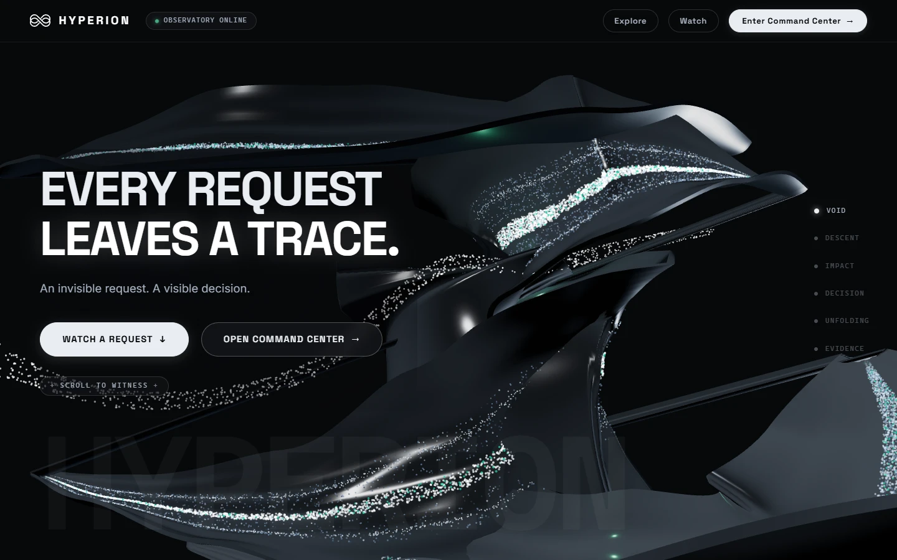
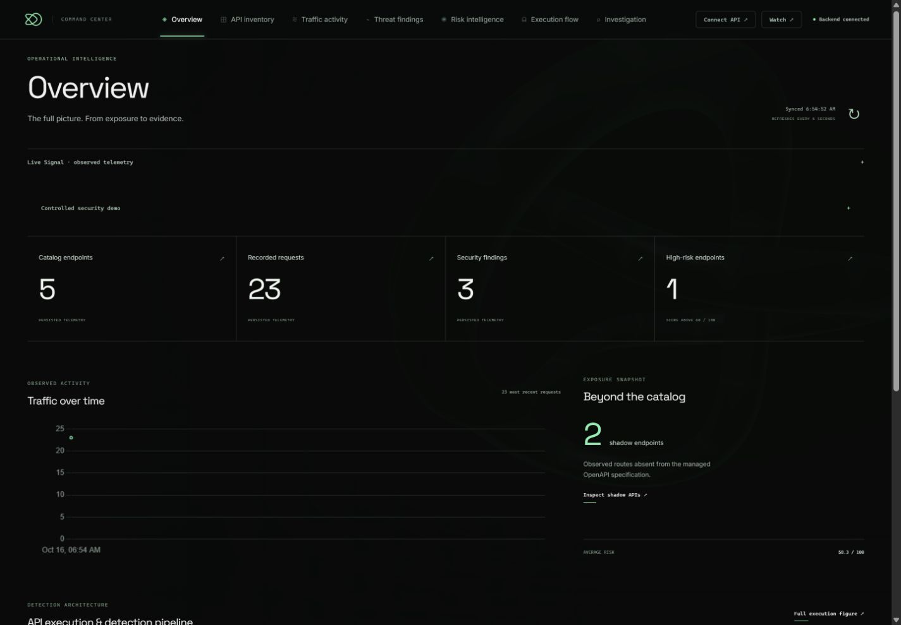
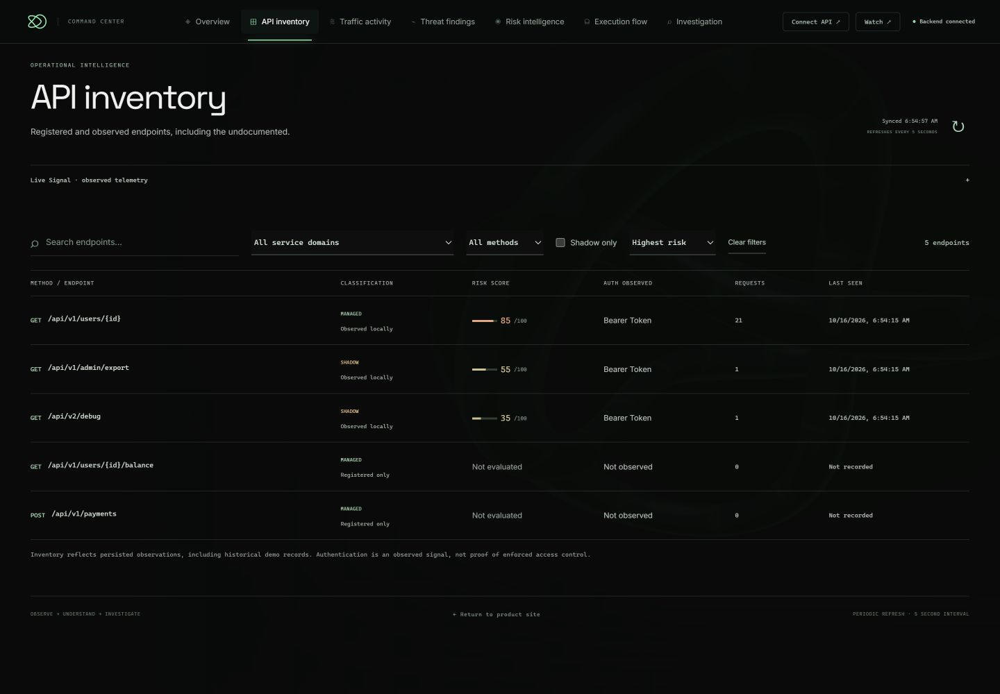
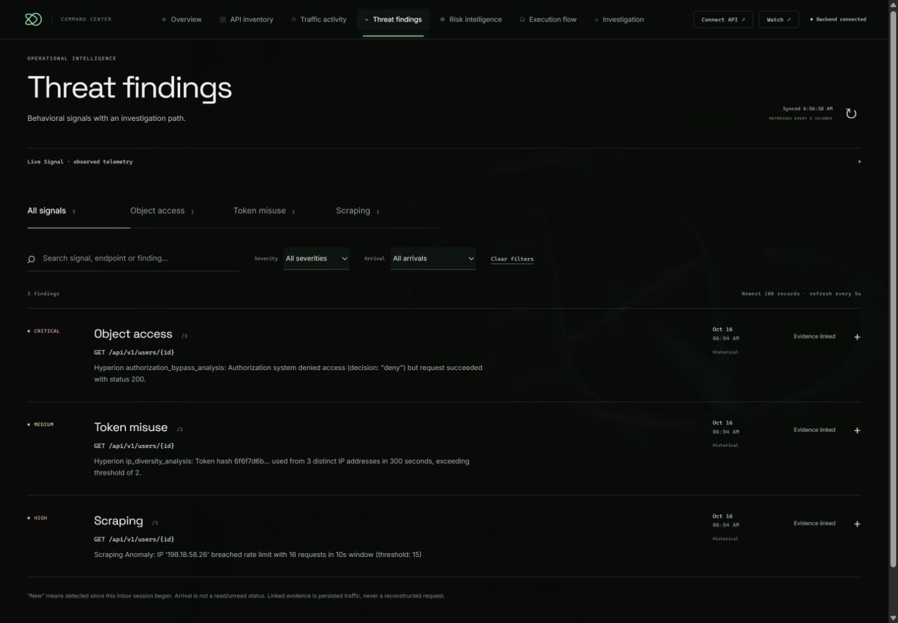
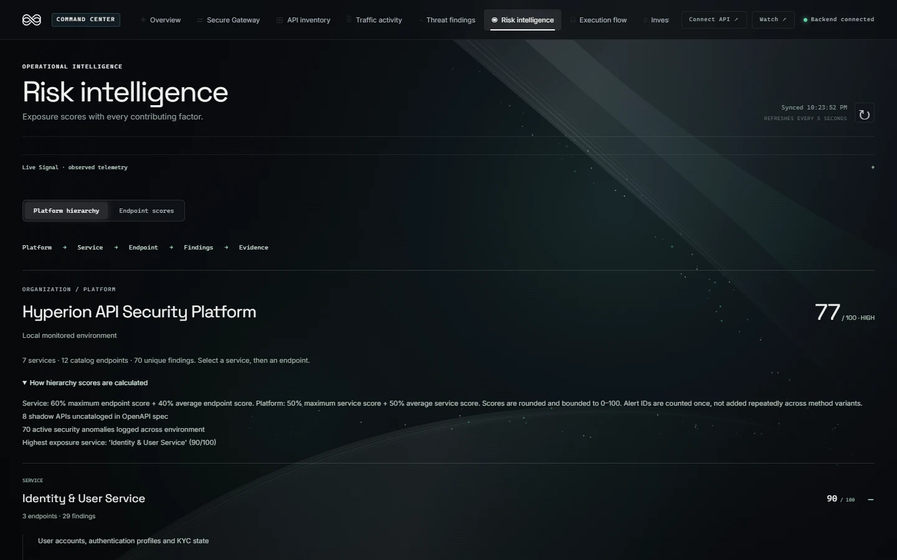
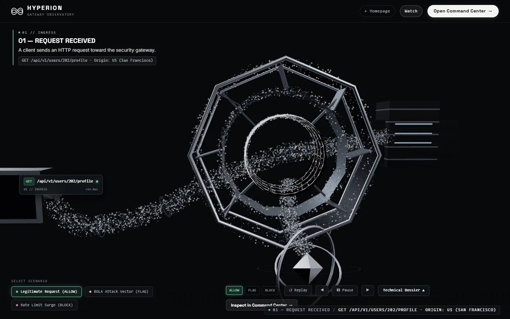

# HYPERION
### Explainable API Security Monitoring & Gateway Enforcement

HYPERION is an explainable API security monitoring and gateway enforcement platform. It bridges the gap between active reverse-proxy traffic interception, behavioral threat detection, and an interactive, translucent Command Center.

By analyzing inbound requests at the gateway boundary before forwarding to upstream protected microservices, HYPERION correlates observed traffic with managed OpenAPI inventories, isolates unauthorized shadow endpoints, detects credential and authorization anomalies (BOLA, token misuse, scraping bursts), derives transparent 0–100 risk scores, and anchors every alert to verifiable, persisted forensic evidence.

---

## 1. What HYPERION Does

- **Real-Time Traffic Interception & Policy Enforcement:** Acts as an intelligent reverse-proxy gateway sitting in front of upstream API services, evaluating requests and enforcing real-time policies: Pass (200), Flag & Audit, or Block (403 Forbidden / 429 Rate Limited).
- **Automated Shadow API Discovery:** Normalizes observed runtime paths and compares them against registered OpenAPI specifications, immediately flagging rogue or undocumented endpoints.
- **Behavioral Anomaly Detection:** Employs specialized security detectors to identify Broken Object-Level Authorization (BOLA/IDOR), multi-origin token reuse, and automated scraping spikes.
- **Explainable Risk Scoring:** Computes deterministic 0–100 endpoint risk scores by aggregating observed threat signals, data sensitivity classifications, and anomaly history into human-auditable mathematical risk factors.
- **Forensic Evidence & Graph Traceability:** Correlates every security incident to full raw request/response headers, parameters, timing, and execution flow logs.
- **Cinematic Experience & Translucent UI:** Integrates a WebGL/Three.js digital sculpture (*The Fractured Veil*) with fluid interactive particle wakes, a guided *Watch HYPERION Work* scenario runner, and an operational dark-glass Command Center.

---

## 2. Architecture Overview

HYPERION operates as a decoupled three-tier architecture:
1. **Protected Upstream API (`127.0.0.1:8001`):** Represents backend business microservices containing sensitive customer, account, and financial resources.
2. **HYPERION Security Gateway & Ingestion Core (`127.0.0.1:8000`):** An asynchronous FastAPI reverse proxy, policy engine, and security intelligence hub. Evaluates traffic in-line, persists forensic records to SQLite, and exposes administrative REST endpoints.
3. **HYPERION Command Center & 3D Experience (`127.0.0.1:5173`):** A high-performance React + TypeScript application featuring Three.js WebGL visualisations, live telemetry polling, interactive threat triage, and incident replay.

---

## 3. Core Capabilities

- **Gateway Reverse Proxy:** High-throughput streaming proxy routing client calls to upstream microservices with minimal latency overhead.
- **Policy Engine:** Declarative rule enforcement including IP rate limits, blocked tokens, and clearance levels (Public, Internal, Confidential).
- **Incident Triaging:** Unified security inbox with severity filters (Critical, High, Medium, Low), detector categories, and one-click evidence drilldown.
- **Live Watch Demonstration:** Built-in controlled scenario engine allowing operators to trigger and review real attacks and policy responses in a guided multi-stage walkthrough.
- **API Catalog Management:** Import OpenAPI specifications, register newly validated routes, and inspect route clearance mappings.
- **Audit Trails:** Immutable-style local database logging for all observed requests, policy decisions, and detector alerts.

---

## 4. Frontend Technologies

- **Runtime & Tooling:** Node.js, Vite 4, TypeScript 5
- **UI Framework & State:** React 18, Tailwind CSS, Heroicons / Lucide React
- **3D Digital Sculpture & Graphics:** Three.js (`0.169.0`), `@react-three/fiber`, custom GLSL shaders (Fractured Veil mesh, titanium/graphite PBR materials, anti-occluded fluid particle stream with cursor wake distortion)
- **Animation & Motion:** GSAP 3.12 (cinematic scroll scrubbing and camera choreographies)
- **Data Visualization:** Chart.js 4, `react-chartjs-2`
- **Testing:** Node.js native test runner (`node:test`)

---

## 5. Backend Technologies

- **Language & Runtime:** Python 3.10+ (tested on Python 3.14)
- **Framework:** FastAPI, Starlette, Uvicorn (ASGI)
- **HTTP Client & Proxy Engine:** `httpx` (asynchronous streaming transport)
- **ORM & Persistence:** SQLAlchemy, SQLite (with additive schema compatibility migrations)
- **Security Engine:** Modular Python detectors (`bola_detector`, `token_misuse_detector`, `scraping_detector`, `injection_detector`, `pii_detector`, `risk_scorer`)
- **Testing:** Python `unittest` standard library

---

## 6. Architecture Diagram

```text
+---------------------------------------------------------------------------------------+
|                                CLIENT / CONSUMER                                      |
|            (Frontend UI @ 5173, Automated Scripts, or External Consumers)             |
+---------------------------------------------------------------------------------------+
                                           |
                                           | HTTP Requests
                                           v
+---------------------------------------------------------------------------------------+
|                        HYPERION SECURITY GATEWAY (:8000)                             |
|                                                                                       |
|   +-----------------------+     +------------------------+     +------------------+   |
|   |   Reverse Proxy &     | --> | Policy Enforcement     | --> | Upstream Request |   |
|   |   Route Normalizer    |     | (Rate Limits & ACL)    |     | Forwarder        |   |
|   +-----------------------+     +------------------------+     +------------------+   |
|               |                             |                            |            |
|               | Async Ingest                | Enforced Decision          | Upstream   |
|               v                             v (Pass/Flag/Block)          | Traffic    |
|   +------------------------------------------------------+               v            |
|   |             Hyperion Security Engine                 |    +-------------------+   |
|   |  - BOLA Detector           - Token Misuse Detector   |    | PROTECTED API     |   |
|   |  - Scraping Detector       - Shadow API Detector     |    | Upstream Service  |   |
|   |  - Risk Scorer (0-100)     - Evidence Correlator     |    | (:8001)           |   |
|   +------------------------------------------------------+    +-------------------+   |
|                             |                                            |            |
|                             v Persist Telemetry & Alerts                 | Response   |
|   +------------------------------------------------------+               |            |
|   |              SQLite Database Persistence             | <-------------+            |
|   |    (Traffic Logs, Endpoint Catalog, Security Alerts) |                            |
|   +------------------------------------------------------+                            |
|                             |                                                         |
|                             v JSON Telemetry & Governance API                         |
+---------------------------------------------------------------------------------------+
                              |
                              | 5-second Polling & Event Ingestion
                              v
+---------------------------------------------------------------------------------------+
|                         HYPERION COMMAND CENTER (:5173)                               |
|                                                                                       |
|   +-------------------+  +-------------------+  +----------------------------------+  |
|   | Overview & Risk   |  | API Inventory &   |  | Threat Findings & Evidence Drill |  |
|   | Hierarchy         |  | Shadow Discovery  |  | (Forensic Request/Response Logs) |  |
|   +-------------------+  +-------------------+  +----------------------------------+  |
|   +--------------------------------------------------------------------------------+  |
|   | Interactive Watch Journey & Fractured Veil 3D WebGL Digital Sculpture          |  |
|   +--------------------------------------------------------------------------------+  |
+---------------------------------------------------------------------------------------+
```

---

## 7. Prerequisites

- **Operating System:** Windows 10/11, macOS, or Linux
- **Python:** 3.10 or later (`python --version`)
- **Node.js:** 18 or later (`node -v`)
- **npm:** 9 or later (`npm -v`)
- **Git:** 2.30+ installed and configured

---

## 8. Windows Local Setup

1. **Clone the repository:**
   ```powershell
   git clone https://github.com/Akkun77/hyperion.git
   cd hyperion
   ```

2. **Configure Python Virtual Environment:**
   ```powershell
   python -m venv .venv
   .\.venv\Scripts\python.exe -m pip install --upgrade pip
   .\.venv\Scripts\python.exe -m pip install -r requirements-dev.txt
   ```

3. **Install Frontend Dependencies:**
   ```powershell
   npm.cmd --prefix frontend ci
   ```

4. **Environment Configuration:**
   Copy `.env.example` to `.env` (optional, default fallbacks are pre-configured for local execution):
   ```powershell
   Copy-Item .env.example .env
   Copy-Item frontend\.env.example frontend\.env.local
   ```

---

## 9. Commands to Start Services

You can launch all services automatically using the provided PowerShell orchestration script, or run them in separate terminals.

### Option A — Automated Startup (Single Script)

```powershell
powershell.exe -ExecutionPolicy Bypass -File .\start-networking.ps1
```
This script initializes the isolated local SQLite database, starts the Protected Upstream API (`:8001`), the Security Gateway (`:8000`), and the Vite Frontend (`:5173`), outputting process IDs and live ports.

### Option B — Manual Startup (Separate Terminals)

**Terminal 1 — Protected Upstream API:**
```powershell
$env:PORT = "8001"
.\.venv\Scripts\python.exe -m uvicorn protected_api:app --app-dir backend --host 127.0.0.1 --port 8001
```

**Terminal 2 — HYPERION Security Gateway & Backend:**
```powershell
$env:HYPERION_DATABASE_PATH = Join-Path $PWD '.local\networking-demo.db'
$env:UPSTREAM_BASE_URL = 'http://127.0.0.1:8001'
.\.venv\Scripts\python.exe -m uvicorn app:app --app-dir backend --host 127.0.0.1 --port 8000
```

**Terminal 3 — Vite Frontend:**
```powershell
$env:VITE_API_BASE = 'http://127.0.0.1:8000'
npm.cmd --prefix frontend run dev -- --host 127.0.0.1 --port 5173
```

Visit **http://127.0.0.1:5173** to access the homepage, `/watch` for the scenario walkthrough, and `/command-center` for the security dashboard.

---

## 10. How to Run Security Demonstrations

### In-Browser Interactive Walkthrough (`/watch`)
1. Navigate to **http://127.0.0.1:5173/watch**.
2. Select any security scenario from the selector panel.
3. Review the authorization banner and click **Execute Scenario**.
4. Use the playback controls (**Previous / Play-Pause / Next / Replay**) to examine each step: Request Dispatch, Gateway Interception, Threat Engine Analysis, Risk Derivation, and Forensic Evidence.

### Command-Line Simulation Scripts
- **Targeted Gateway Verification:**
  ```powershell
  .\.venv\Scripts\python.exe verify_demo.py
  ```
  Validates system health, upstream proxy reachability, policy decision enforcement, and database event persistence.

- **Continuous Append-Only Traffic Simulator:**
  ```powershell
  .\.venv\Scripts\python.exe simulate.py
  ```
  Generates a diverse stream of realistic traffic (normal transactions, scraping spikes, token abuse, and shadow endpoint scans) against the gateway to populate live dashboard charts.

---

## 11. Representative Scenarios

| Scenario | Attack Type | Gateway Decision | Detection & Evidence Description |
|---|---|---|---|
| **1. Legitimate Transaction** | Normal User Operation | `PASS` (HTTP 200) | Authenticated customer fetches their own account profile (`/api/v1/user/profile`). Gateway validates schema, clearances match, upstream serves data. |
| **2. BOLA / IDOR Attempt** | Broken Object-Level Auth | `FLAG` / `ALERT` | User authenticated with token `USR-9812` requests account records belonging to `ACC-0042`. Detector flags user-to-resource ownership mismatch. |
| **3. Token Reuse Anomaly** | Credential Misuse | `FLAG` / `BLOCKED` | Single Bearer token submitted simultaneously from multiple distinct geographic IP subnets within a 2-second window. |
| **4. Scraping Burst** | Automated Resource Enumeration | `BLOCK` (HTTP 429) | Client fires high-frequency requests across numerical entity IDs (`/api/v1/records/1..100`). Gateway rate limiter trips, shedding load. |
| **5. Shadow API Discovery** | Undocumented Endpoint Scan | `FLAG` (Observed) | Inbound traffic observed on `/api/v2/debug` and `/api/v1/admin/export`. Gateway alerts that routes are absent from the approved OpenAPI spec. |

---

## 12. Application Gallery & Visual Screenshots

| View | Description | Screenshot |
|---|---|---|
| **Fractured Veil Homepage** | 3D WebGL sculpture with interactive fluid particle wake and titanium materials. |  |
| **Command Center Overview** | Real-time traffic throughput, threat score distribution, and shadow API counter. |  |
| **API Inventory** | Route catalog comparing approved specifications against discovered shadow endpoints. |  |
| **Threat Findings** | Incident inbox with detector categorization, severity tags, and evidence links. |  |
| **Risk Intelligence** | Multi-level hierarchy explaining platform and service risk score derivation. |  |
| **Watch Interactive Walkthrough**| Multi-stage scenario inspection with step-by-step forensic verification. |  |

*Full screenshot provenance and captures are documented in [docs/screenshots/README.md](docs/screenshots/README.md).*

---

## 13. Testing Instructions

### Backend Test Suite
Run all Python security engine, policy, and integration test suites:
```powershell
# Run security engine unit tests
.\.venv\Scripts\python.exe -m unittest discover -s backend/hyperion_security_engine/tests -t backend -v

# Run root backend integration tests
.\.venv\Scripts\python.exe -m unittest discover -s tests -v
```

### Frontend Verification Suite
Run TypeScript compilation check, unit tests, and production build:
```powershell
# TypeScript static type check
npm.cmd --prefix frontend run typecheck

# Unit tests
npm.cmd --prefix frontend test

# Production build verification
npm.cmd --prefix frontend run build
```

---

## 14. Project Structure

```text
HYPERION/
├── backend/
│   ├── database/                    # SQLite client, SQLAlchemy models, and seed data
│   │   ├── db_client.py
│   │   ├── models.py
│   │   └── seed.py
│   ├── engine/                      # Deterministic risk scoring algorithms
│   │   └── risk_scorer.py
│   ├── gateway/                     # Reverse proxy, policy evaluation, and demo scenarios
│   │   ├── demo.py
│   │   ├── policy.py
│   │   ├── proxy.py
│   │   └── state.py
│   ├── hyperion_security_engine/    # Specialized threat detectors (BOLA, scraping, tokens)
│   │   ├── bola_detector.py
│   │   ├── injection_detector.py
│   │   ├── pii_detector.py
│   │   ├── scraping_detector.py
│   │   └── token_misuse_detector.py
│   ├── app.py                       # Unified FastAPI application entry point
│   └── protected_api.py             # Mock upstream microservice (:8001)
├── contracts/                       # API contracts and specifications
│   └── api_spec.yaml
├── docs/                            # Documentation and reference captures
│   ├── DESIGN_SYSTEM.md
│   ├── screenshots/
│   └── MIGRATION.md
├── frontend/                        # React + TypeScript + Vite user interface
│   ├── src/
│   │   ├── components/              # Command Center panels (Overview, Inventory, Findings)
│   │   ├── context/                 # Application state providers
│   │   ├── vnext/                   # Fractured Veil 3D WebGL scene & shaders
│   │   │   ├── scene/               # Sculpture geometry, materials, and lighting
│   │   │   └── shaders/             # Particle physics and streamline GLSL shaders
│   │   └── App.tsx                  # Main router and layout
│   ├── package.json
│   ├── tsconfig.json
│   └── vite.config.ts
├── .env.example                     # Safe environment configuration template
├── .gitignore                       # Repository exclusion rules
├── requirements.txt                 # Backend runtime dependencies
├── requirements-dev.txt             # Development and test dependencies
├── simulate.py                      # Continuous traffic generation script
├── start-networking.ps1             # Windows service startup automation
└── verify_demo.py                   # Automated end-to-end verification script
```

---

## 15. Current Limitations

- **Local Demonstration Scope:** Designed and verified as a high-fidelity local demonstration prototype. Does not provide out-of-the-box distributed Kubernetes ingress or eBPF kernel-level bypass.
- **Protocol Support:** Currently evaluates HTTP/1.1 REST JSON API traffic; WebSockets, gRPC, and GraphQL payload inspection are planned for future versions.
- **Storage Backend:** Employs SQLite with thread-safe connection pooling for local portability; production deployment would swap the SQLAlchemy database URI for a distributed PostgreSQL cluster.
- **TLS Termination:** Assumes TLS is terminated at an outer ingress layer (e.g., Cloudflare, AWS ALB) before reaching the local gateway instance.
