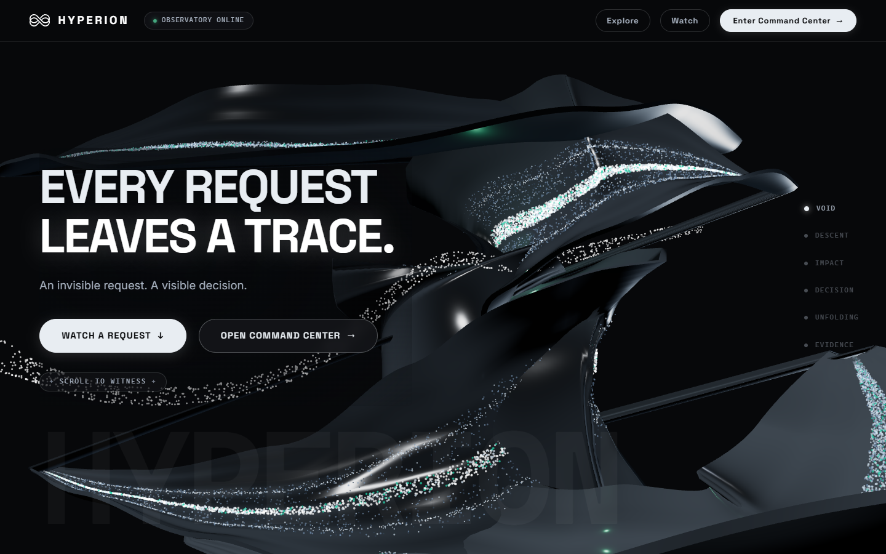
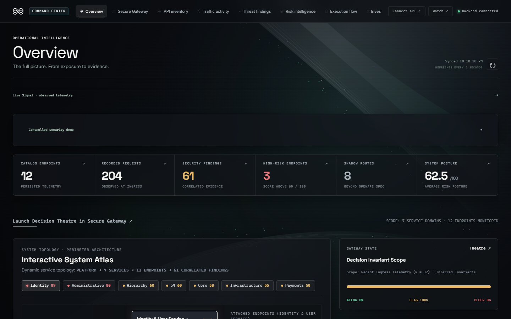
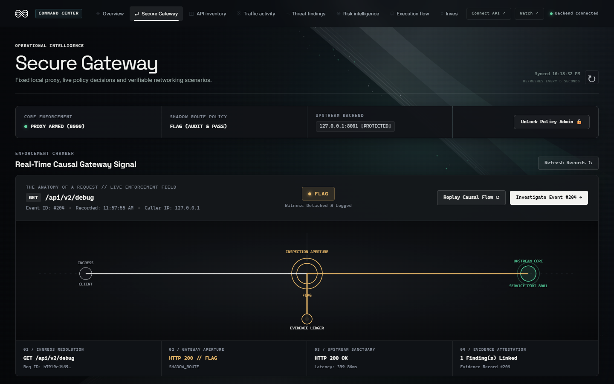
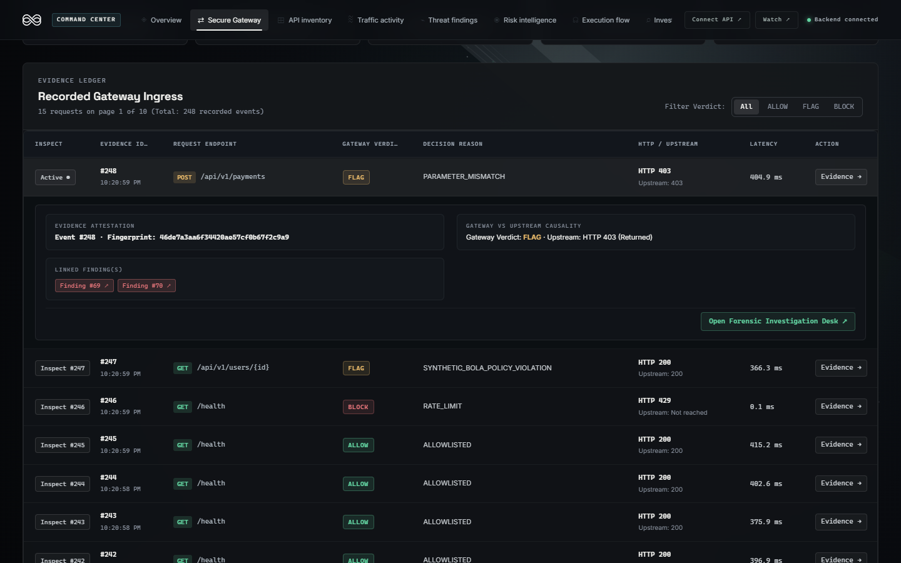
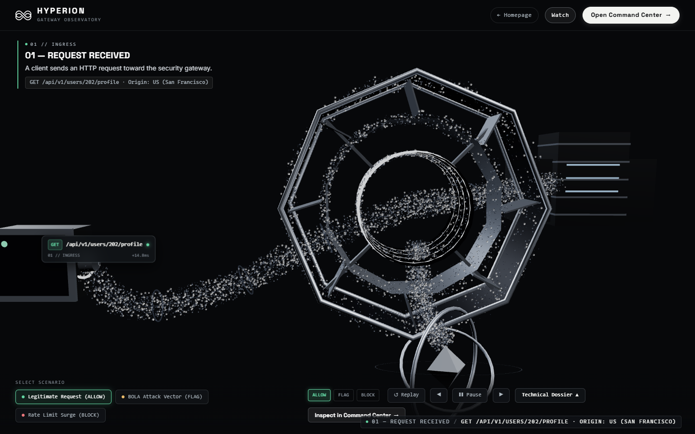
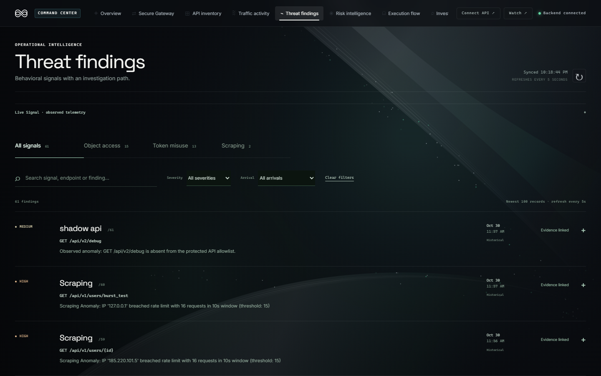
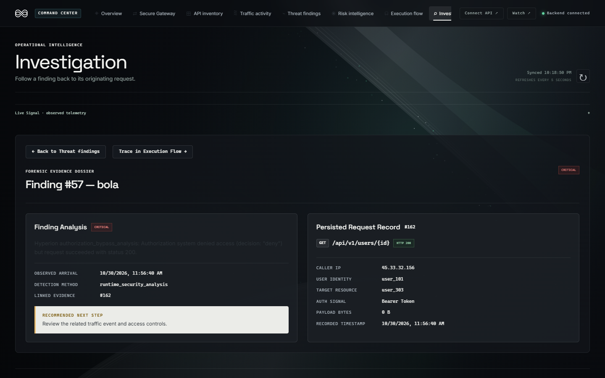
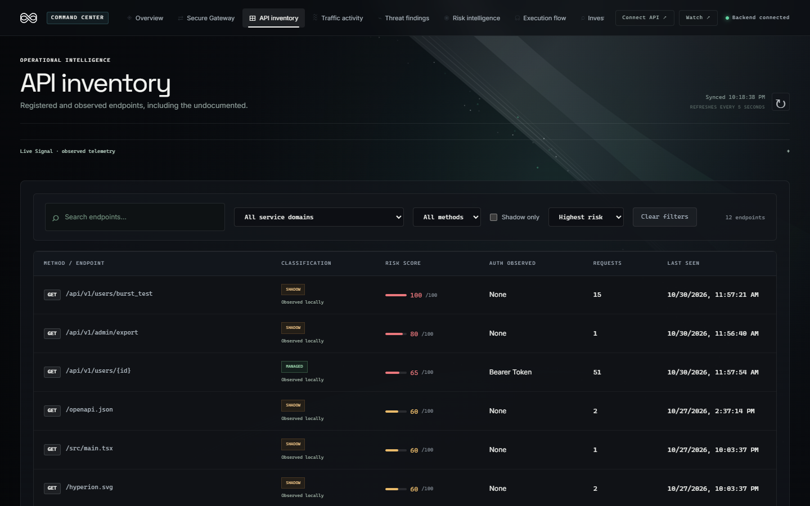
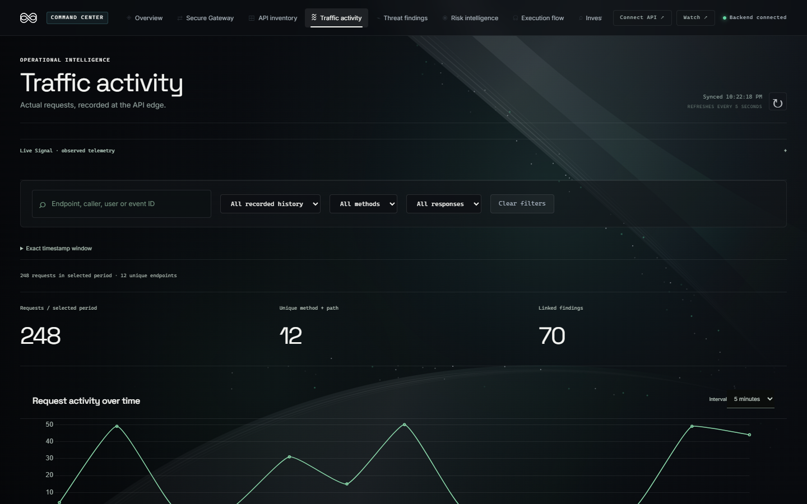
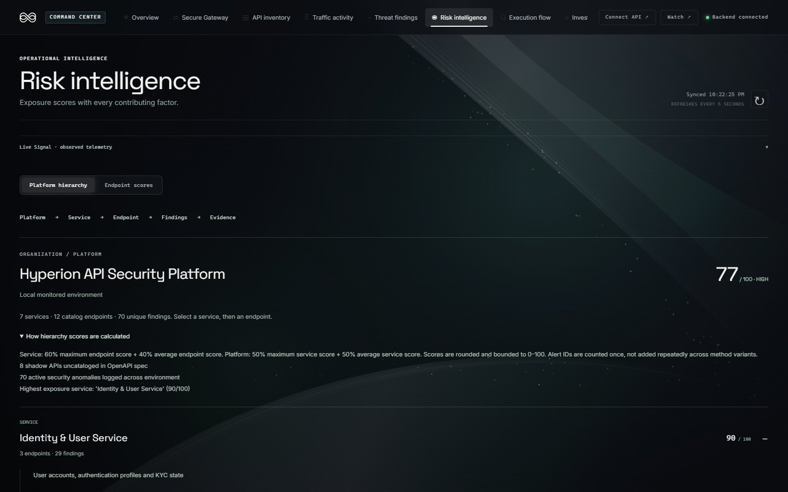

# HYPERION
### Explainable API Security Monitoring & Gateway Enforcement

HYPERION is an explainable API security monitoring and network observability system. It unites active reverse-proxy traffic interception, behavioral threat detection, deterministic risk scoring, and linked forensic evidence within an interactive, translucent Command Center.

By evaluating inbound requests at the gateway boundary before forwarding them to upstream microservices, HYPERION correlates observed traffic with managed OpenAPI inventories, isolates unauthorized shadow endpoints, detects credential and authorization anomalies, and anchors every alert to verifiable, persisted forensic records.

---

## Visual Showcase



*The Fractured Veil 3D WebGL sculpture with real-time fluid particle streamlines, white infinity emblem, and interactive cursor wake deflection ("EVERY REQUEST LEAVES A TRACE").*

---

## 1. System Overview & Core Capabilities

- **Active Reverse-Proxy Enforcement:** Sits in-line before protected upstream microservices (`127.0.0.1:8001`), evaluating inbound traffic and enforcing decisions: **ALLOW** (HTTP 200), **FLAG** (Audit & Pass), or **BLOCK** (HTTP 403 / 429).
- **Shadow API Discovery:** Normalizes observed runtime paths and matches them against approved OpenAPI specifications, immediately flagging rogue or undocumented endpoints.
- **Behavioral Threat Detectors:** Identifies Broken Object-Level Authorization (BOLA/IDOR), multi-origin token replay, and high-frequency scraping bursts.
- **Explainable Risk Scoring:** Computes deterministic 0–100 endpoint risk scores by aggregating observed threat signals, data sensitivity classifications, and anomaly history into human-auditable mathematical risk factors.
- **Forensic Evidence Traceability:** Connects every security alert directly to raw request/response headers, parameters, timing, and execution flow logs.
- **Interactive Command Center:** Provides an operational dark-glass workspace featuring telemetry monitoring, incident triage, and forensic drilldowns.

---

## 2. Distinction of System Modes

To ensure engineering rigor, HYPERION explicitly distinguishes between its operational modes:

| Mode | Purpose | Implementation Detail |
|---|---|---|
| **Live Operational Features** | Real-time traffic interception & monitoring | Asynchronous FastAPI reverse proxy with streaming `httpx` transport, policy engine, and SQLite audit persistence polled at 5-second intervals. |
| **Controlled Demonstrations** | Verifiable security scenario testing | Built-in scenario suite (`simulate.py` / `/command-center/gateway`) transmitting authentic requests to verify policy enforcement and database persistence. |
| **Cinematic Explanatory Visualizations** | System intuition & visual narrative | Native Three.js WebGL digital sculpture (*The Fractured Veil*) and GLSL particle streamlines illustrating request journeys. |

---

## 3. Application Gallery

### A. Operational Command Center & Perimeter Topology



*Command Center Overview: Live KPI telemetry (catalog endpoints, recorded requests, active alerts, shadow routes), real-time gateway decision breakdown, and the Interactive System Atlas.*

---

### B. Active Gateway Enforcement & Policy Outcomes



*Secure Gateway Core: Visualizes the proxy boundary (`:8000`), upstream microservice target (`:8001`), active shadow policy, and real-time causal request flow.*



*Real-Time Gateway Demonstration: Filterable Evidence Ledger displaying verified **ALLOW**, **FLAG**, and **BLOCK** decisions with reason codes, latency, and linked finding attestations.*

---

### C. Interactive Request Journey



*Watch HYPERION Work: Multi-stage cinematic walkthrough tracking an inbound request from client ingress, through the octagonal gateway inspection aperture, to policy enforcement and upstream response.*

---

### D. Threat Intelligence & Forensic Investigation



*Threat Findings Inbox: Unified security queue with detector classifications (BOLA, Token Misuse, Scraping, Shadow API), severity indicators, and one-click evidence investigation paths.*



*Forensic Investigation: Deep-linked dossier (Finding #57 — BOLA) displaying the offending session caller, target resource, auth signal, and correlated raw request record (#162).*

---

### E. Inventory Discovery & Risk Hierarchy



*API Inventory: Discovered endpoints cataloged by classification (Managed vs. Shadow), risk score, authentication requirement, request count, and last-observed timestamp.*



*Traffic Activity: Server-side request volume curves over time, response code distributions, method breakdowns, and suspicious activity volume.*



*Risk Intelligence Hierarchy: Multi-level exposure breakdown from Platform (77/100) down to Services and Endpoints, revealing transparent mathematical formula factors and drivers.*

---

## 4. Architecture & Technical Stack

```text
+---------------------------------------------------------------------------------------+
|                                CLIENT / CONSUMER                                      |
|            (Frontend UI @ 5173, Automated Scripts, or External Consumers)             |
+---------------------------------------------------------------------------------------+
                                           |
                                           | HTTP Requests
                                           v
+---------------------------------------------------------------------------------------+
|                        HYPERION SECURITY GATEWAY (:8000)                             |
|                                                                                       |
|   +-----------------------+     +------------------------+     +------------------+   |
|   |   Reverse Proxy &     | --> | Policy Enforcement     | --> | Upstream Request |   |
|   |   Route Normalizer    |     | (Rate Limits & ACL)    |     | Forwarder        |   |
|   +-----------------------+     +------------------------+     +------------------+   |
|               |                             |                            |            |
|               | Async Ingest                | Enforced Decision          | Upstream   |
|               v                             v (ALLOW / FLAG / BLOCK)     | Traffic    |
|   +------------------------------------------------------+               v            |
|   |             Hyperion Security Engine                 |    +-------------------+   |
|   |  - BOLA Detector           - Token Misuse Detector   |    | PROTECTED API     |   |
|   |  - Scraping Detector       - Shadow API Detector     |    | Upstream Service  |   |
|   |  - Risk Scorer (0-100)     - Evidence Correlator     |    | (:8001)           |   |
|   +------------------------------------------------------+    +-------------------+   |
|                             |                                            |            |
|                             v Persist Telemetry & Alerts                 | Response   |
|   +------------------------------------------------------+               |            |
|   |              SQLite Database Persistence             | <-------------+            |
|   |    (Traffic Logs, Endpoint Catalog, Security Alerts) |                            |
|   +------------------------------------------------------+                            |
|                             |                                                         |
|                             v JSON Telemetry & Governance API                         |
+---------------------------------------------------------------------------------------+
                              |
                              | 5-second Polling & Event Ingestion
                              v
+---------------------------------------------------------------------------------------+
|                         HYPERION COMMAND CENTER (:5173)                               |
|                                                                                       |
|   +-------------------+  +-------------------+  +----------------------------------+  |
|   | Overview & Risk   |  | API Inventory &   |  | Threat Findings & Evidence Drill |  |
|   | Hierarchy         |  | Shadow Discovery  |  | (Forensic Request/Response Logs) |  |
|   +-------------------+  +-------------------+  +----------------------------------+  |
|   +--------------------------------------------------------------------------------+  |
|   | Interactive Watch Journey & Fractured Veil 3D WebGL Digital Sculpture          |  |
|   +--------------------------------------------------------------------------------+  |
+---------------------------------------------------------------------------------------+
```

### Frontend Technologies
- **Runtime & Tooling:** Node.js, Vite 4, TypeScript 5
- **UI Framework & State:** React 18, Tailwind CSS
- **3D Graphics & Shaders:** Three.js (`0.169.0`), `@react-three/fiber`, custom GLSL shaders (Fractured Veil mesh, titanium/graphite PBR materials, anti-occluded fluid particle streamlines with cursor wake deflection)
- **Animation & Motion:** GSAP 3.12 (cinematic scroll scrubbing and camera choreographies)
- **Data Visualization:** Chart.js 4, `react-chartjs-2`
- **Testing:** Node.js native test runner (`node:test`)

### Backend Technologies
- **Language & Runtime:** Python 3.10+ (tested on Python 3.14)
- **Framework:** FastAPI, Starlette, Uvicorn (ASGI)
- **Proxy Transport:** `httpx` (asynchronous streaming client)
- **ORM & Storage:** SQLAlchemy, SQLite (with additive schema compatibility migrations)
- **Security Engine:** Modular Python detectors (`bola_detector`, `token_misuse_detector`, `scraping_detector`, `injection_detector`, `pii_detector`, `risk_scorer`)
- **Testing:** Python `unittest` standard library

---

## 5. Prerequisites & Local Setup

### Prerequisites
- **Operating System:** Windows 10/11, macOS, or Linux
- **Python:** 3.10 or higher (`python --version`)
- **Node.js:** 18 or higher (`node -v`)
- **npm:** 9 or higher (`npm -v`)
- **Git:** 2.30+ installed and configured

### Installation Steps

1. **Clone the repository:**
   ```powershell
   git clone https://github.com/Akkun77/hyperion.git
   cd hyperion
   ```

2. **Configure Python Virtual Environment:**
   ```powershell
   python -m venv .venv
   .\.venv\Scripts\python.exe -m pip install --upgrade pip
   .\.venv\Scripts\python.exe -m pip install -r requirements-dev.txt
   ```

3. **Install Frontend Dependencies:**
   ```powershell
   npm.cmd --prefix frontend ci
   ```

4. **Environment Configuration:**
   Copy the provided safe configuration examples:
   ```powershell
   Copy-Item .env.example .env
   Copy-Item frontend\.env.example frontend\.env.local
   ```

---

## 6. Starting Services

### Option A — Automated Startup (Single Script)

```powershell
powershell.exe -ExecutionPolicy Bypass -File .\start-networking.ps1
```
This script initializes the isolated local SQLite database, starts the Protected Upstream API (`:8001`), the Security Gateway (`:8000`), and the Vite Frontend (`:5173`).

### Option B — Manual Startup (Separate Terminals)

**Terminal 1 — Protected Upstream API:**
```powershell
$env:PORT = "8001"
.\.venv\Scripts\python.exe -m uvicorn protected_api:app --app-dir backend --host 127.0.0.1 --port 8001
```

**Terminal 2 — HYPERION Security Gateway & Backend:**
```powershell
$env:HYPERION_DATABASE_PATH = Join-Path $PWD '.local\networking-demo.db'
$env:UPSTREAM_BASE_URL = 'http://127.0.0.1:8001'
.\.venv\Scripts\python.exe -m uvicorn app:app --app-dir backend --host 127.0.0.1 --port 8000
```

**Terminal 3 — Vite Frontend:**
```powershell
$env:VITE_API_BASE = 'http://127.0.0.1:8000'
npm.cmd --prefix frontend run dev -- --host 127.0.0.1 --port 5173
```

Visit **http://127.0.0.1:5173** for the Fractured Veil homepage, `/watch` for the interactive scenario journey, and `/command-center` for the operational dashboard.

---

## 7. Security Demonstrations

| Scenario | Attack Type | Gateway Decision | Detection & Evidence Description |
|---|---|---|---|
| **1. Legitimate Transaction** | Normal User Operation | `ALLOW` (HTTP 200) | Authenticated customer fetches their profile (`/api/v1/users/user_101`). Schema validated, clearance matched, upstream serves data. |
| **2. BOLA / IDOR Attempt** | Broken Object-Level Auth | `FLAG` (Audited) | Session token `USR-9812` requests account records belonging to `ACC-0042`. Detector flags user-to-resource ownership mismatch. |
| **3. Token Reuse Anomaly** | Credential Misuse | `FLAG` / `BLOCKED` | Single Bearer token observed simultaneously across multiple distinct geographic IP subnets within a 2-second window. |
| **4. Scraping Burst** | Automated Resource Enumeration | `BLOCK` (HTTP 429) | High-frequency requests across entity IDs (`/api/v1/records/1..100`). Gateway rate limiter trips, shedding load. |
| **5. Shadow API Discovery** | Undocumented Endpoint Scan | `FLAG` (Observed) | Inbound traffic observed on `/api/v2/debug` and `/api/v1/admin/export`. Gateway alerts that routes are absent from approved OpenAPI catalog. |

To trigger these scenarios from the command line:
```powershell
# Continuous realistic traffic generator
.\.venv\Scripts\python.exe simulate.py

# End-to-end verification script
.\.venv\Scripts\python.exe verify_demo.py
```

---

## 8. Verification & Test Suites

```powershell
# Backend unit tests
.\.venv\Scripts\python.exe -m unittest discover -s backend/hyperion_security_engine/tests -t backend -v

# Backend integration tests
.\.venv\Scripts\python.exe -m unittest discover -s tests -v

# Frontend TypeScript checking
npm.cmd --prefix frontend run typecheck

# Frontend unit tests
npm.cmd --prefix frontend test

# Frontend production build
npm.cmd --prefix frontend run build
```

---

## 9. Repository Layout

| Path | Description |
|---|---|
| `backend/` | Unified FastAPI backend, reverse-proxy gateway (`gateway/`), SQLite persistence, and threat detectors (`hyperion_security_engine/`) |
| `frontend/` | React 18 application, Three.js WebGL shaders (`src/vnext/`), and Command Center workspace (`src/workspace/`) |
| `contracts/` | OpenAPI specifications and schema contracts (`api_spec.yaml`) |
| `docs/` | Architecture blueprints, design documentation, and screenshot gallery (`docs/screenshots/`) |
| `tests/` | Comprehensive gateway and platform integration tests |
| `simulate.py` | Continuous traffic generation script for local demonstrations |
| `start-networking.ps1`| PowerShell service startup automation |
| `verify_demo.py` | Automated end-to-end gateway and evidence verification script |

---

## 10. Limitations & Boundaries

- **Local Demonstration Scope:** Designed and verified as a high-fidelity local demonstration prototype. Does not provide out-of-the-box distributed Kubernetes ingress controllers or eBPF kernel-level bypass.
- **Protocol Evaluation:** Evaluates HTTP/1.1 REST JSON API traffic; WebSockets, gRPC, and GraphQL payload inspection are planned for future releases.
- **Storage Backend:** Uses SQLite with connection pooling for local portability; production deployment would configure a distributed PostgreSQL cluster.
- **TLS Termination:** Assumes TLS is terminated at an outer ingress layer (e.g., Cloudflare, AWS ALB) before reaching the gateway instance.
- **Cinematic Visuals:** 3D WebGL animations serve as explanatory visualizations of traffic dynamics; they do not represent low-level packet captures.
